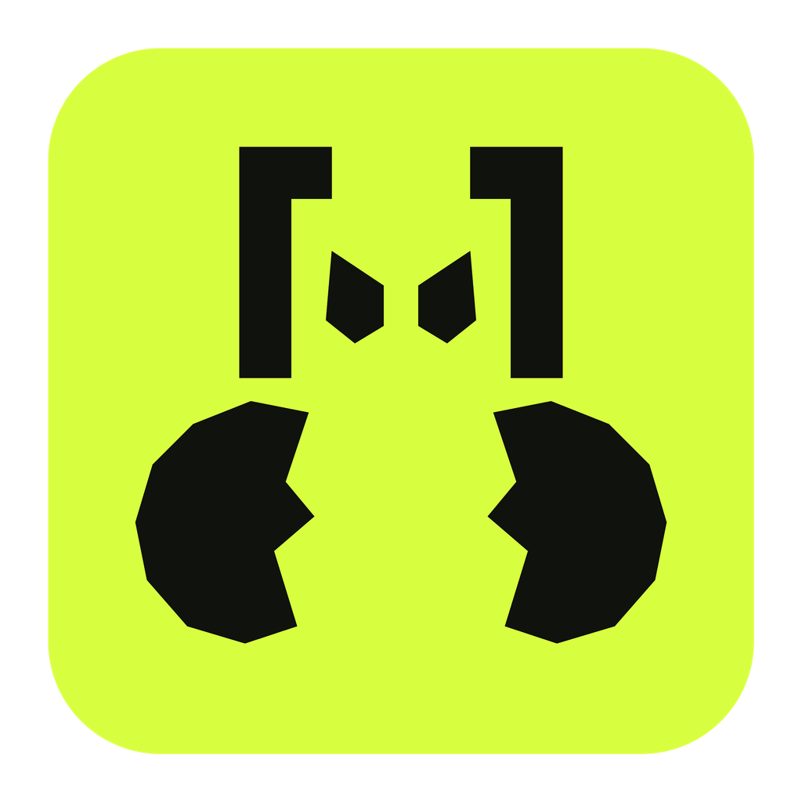

# pinch


**Your agents start things. Pinch keeps count.**

A tiny daemon with an unreasonable commitment to your RAM. Pinch keeps your
agents' dev servers accounted for: who started them, where they're listening,
and what they're eating. When something looks forgotten, it asks whether you
still need it.

- **One server is enough.** Agents reuse existing servers instead of starting duplicates.
- **Know what's running.** Ports, logs, CPU, memory, and agent attribution in
  your menu bar.
- **Clean up on your terms.** Stop, keep running, or snooze. Your servers survive
  Pinch updates and restarts.

## Get Pinch

macOS 13+ · Apple Silicon

```sh
curl -fsSL https://github.com/peelar/pinch/releases/latest/download/install.sh | bash
```

Open **Pinch** from `~/Applications` and click **Install skill** to connect
your detected Claude Code and Codex installations. Your agents handle the CLI;
you keep an eye on things from the menu bar.

Builds are currently ad hoc signed. If macOS blocks the app, see
[installation help](DEVELOPMENT.md#install-and-update).

[Agent instructions](docs/agent-instructions.md) ·
[Development](DEVELOPMENT.md) ·
[Releases](https://github.com/peelar/pinch/releases) ·
[Contributing](CONTRIBUTING.md) ·
[MIT license](LICENSE)
